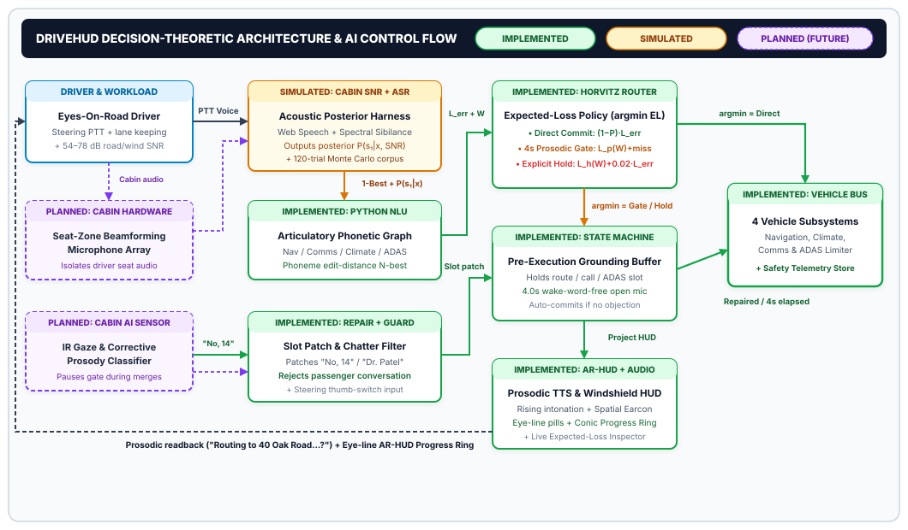
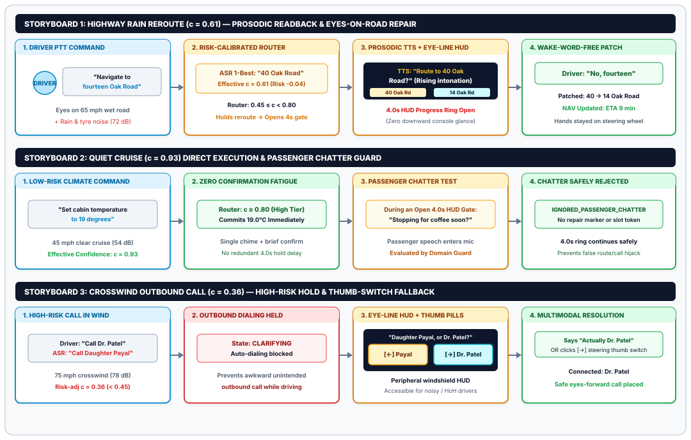

# Project Report: DriveHUD — Decision-Theoretic Pre-Execution Grounding and Verbal Repair in Eyes-Free In-Car VUIs

**[Utkarsh Dev] | [3149895] | [Intelligent Interactive Systems] | [University of Birmingham] | [Professor Eyal Ofek] | [25 November 2026]**  
**Total Report Word Count: 1210 words (Abstract: 257 words | Main Report including Rationale Table: 953 words)**

## Abstract (257 words)

In-car voice user interfaces (VUIs) enable eyes-free control of navigation, communications, climate, and driver-assistance settings while visual and manual attention remain occupied on traffic. However, when road, rain, or crosswind noise (50–82 dB) causes automatic speech recognition (ASR) phonetic confusions (e.g., “14 Oak Road” versus “40 Oak Road”, or “Dr. Patel” versus “Daughter Payal”), commercial automotive VUIs conceal low acoustic certainty, commit the misheard action silently, and close the microphone channel. Discovering errors post-execution forces dangerous downward console glances and multi-turn wake-word restarts.

To resolve this breakdown, this project presents DriveHUD, a full-stack Python and web-based automotive cockpit and Augmented-Reality Windshield Head-Up Display (AR-HUD) implementing decision-theoretic pre-execution grounding and wake-word-free verbal slot repair. Grounded in Horvitz’s (1999) expected-utility framework, DriveHUD evaluates posterior slot confidence P(s1|x), domain irreversibility loss L_err (weighting outbound calls and speed limiters above reversible climate tweaks), and dynamic driving workload W to select the minimum-expected-loss policy: Direct Commit, a 4.0-second Prosodic Readback Gate (“Routing to FORTY Oak Road...?”) paired with forward-eye-line HUD pills, or Explicit Hold. Drivers intercept misheard slots mid-turn via single-phrase patching (“No, fourteen”) while a domain-scoped grammar filters out passenger chatter.

Current scope encompasses a working Python REST engine, articulatory phonetic confusion graph across four vehicle subsystems, interactive lane-keeping AR-HUD, hybrid audio pipeline, and a 120-trial Monte Carlo policy benchmark (reducing silent errors from 28.3% to 10.8% while keeping confirmation fatigue at 1.7% versus 44.2% for static prompts). Cabin SNR posteriors are simulated; seat-zone microphone beamforming and infrared gaze tracking remain planned.

## 1. Design Rationale and Project Explanation

In Assignment 1, literature synthesis across conversational breakdown taxonomies (Benner et al., 2021; Alghamdi et al., 2024), eyes-free speech guidelines (Murad et al., 2018; Kontogiorgos et al., 2021), and real-world turn-taking analyses (Albert et al., 2023) identified a core limitation in spoken assistants: reliance on reactive post-failure repair rather than proactive pre-execution interception. Through Norman’s (2013) action cycle (Week 1), silent execution under acoustic ambiguity creates a compounded safety hazard while driving: a Gulf of Evaluation, because internal ASR uncertainty remains invisible until a wrong route or outbound call activates, and a high-distraction Gulf of Execution, forcing visual attention toward a center touchscreen or repetitive wake-word restarts.

*Figure 1: Baseline five-stage hands-free VUI interaction loop (reused from Assignment 1), illustrating how low-confidence speech-to-text inferences bypass pre-execution grounding and close the microphone prematurely.*

Developing our initial Assignment 1 concept revealed that a static domestic timer form could not capture continuous attentional demand or asymmetric action risk. Pivoting to DriveHUD enabled a rigorous application of Weeks 1–4 concepts. Operationalizing Horvitz’s (1999) mixed-initiative utility principles (Week 3) alongside Amershi et al.’s (2019) Guidelines G2 (Make clear how well the system can do what it can do) and G10 (Scope services when in doubt) (Week 2), DriveHUD computes expected loss across three policies using posterior P(s1|x), domain error cost L_err (9.2 for outbound calls, 8.8 for speed limiters, 7.6 for navigation, 3.8 for climate), and driving workload W. When prosodic gating minimizes expected loss, Guidelines G8 (Efficient dismissal) and G9 (Efficient correction) shape a 4.0-second wake-word-free open-mic window supporting natural next-turn self-repair (Clark & Brennan, 1991; Albert et al., 2023).

### Table 1: Design Rationale, Implementation Status, and Supporting Evidence

| Design choice | Status | Why it suits the problem | Supporting evidence or reference |
| --- | --- | --- | --- |
| Horvitz expected-loss policy router (Direct Commit vs. 4.0s Prosodic Gate vs. Explicit Hold) | Implemented (Python Engine) / Simulated (Posterior P) | Replaces brittle static thresholds by minimizing expected cost across domain irreversibility L_err and speed/noise workload W, cutting confirmation fatigue. | Horvitz (1999) mixed-initiative utility model; Amershi et al. (2019) G10 (Scope services when in doubt); verified in 120-trial benchmark (1.7% vs. 44.2% fatigue). |
| Prosodically stressed implicit readback (natural CarPlay voice + rising intonation) + spatial earcons | Implemented | Bridges Norman’s (2013) Gulf of Evaluation eyes-free by encoding recognition uncertainty into questioning intonation without forcing an extra turn when ASR is right. | Amershi et al. (2019) G2 (Communicate uncertainty); Murad et al. (2018) eyes-free auditory feedback heuristics; Kontogiorgos et al. (2021). |
| 4.0-second wake-word-free repair window with articulatory N-best slot patching | Implemented | Narrows Norman’s (2013) Gulf of Execution by enabling mid-turn slot replacement (“No, 14”), confirmation (“Yes”), or abort (“Cancel”) with hands on the wheel. | Albert et al. (2023) Conversation Analysis of premature turn closure; Amershi et al. (2019) G8 (Dismissal) and G9 (Efficient correction). |
| Forward-eye-line AR-HUD pills + semantic conic progress ring + steering thumb shortcuts | Implemented | Prevents downward console glances during active lane-keeping workload and provides WCAG-compliant visual/tactile redundancy for hard-of-hearing drivers. | Inclusive multimodal redundancy (Week 4); Alghamdi et al. (2024) scoping review on minimizing cognitive load during spoken repair. |
| Domain-scoped repair grammar and passenger-chatter false-activation guard | Implemented | Prevents cabin conversation during the 4.0s open-mic window from hijacking navigation routes, speed limiters, or outbound calls. | Directly resolves the open-mic false-activation limitation identified in Assignment 1; verified by automated Test 2 in drivehud_engine.py. |
| Cabin SNR model (50–82 dB), active crosswind steering task, and 120-trial benchmark | Simulated | Isolates policy evaluation from browser cloud-ASR variance while enabling repeatable quantitative comparison against Baseline OEM and static binary prompts. | Development testing exposed missing cloud ASR keys in embedded webviews; Monte Carlo simulation quantifies turn efficiency (1.41 vs. 2.07 turns). |
| Seat-zone beamforming microphone array | Planned | Would spatially isolate driver speech from passenger chatter and road rumble at the acoustic front-end in production vehicles. | Albert et al. (2023) multi-party noise findings; requires physical multi-microphone automotive DSP hardware. |
| Infrared driver gaze and corrective prosody detector | Planned | Would pause the 4.0s gate during high-demand highway merges and fuse hyper-articulated pitch stress with lexical repair parsing. | Alghamdi et al. (2024) prosodic repair shifts; Horvitz (1999) attentional-state inference. |

## 2. System Architecture and Development Decisions

Figure 2 depicts DriveHUD’s full-stack architecture connecting the AR cockpit (`index.html`, `app.js`) to the Python decision-theoretic backend (`server.py`, `drivehud_engine.py`). Three engineering refinements shaped development. First, calibrating expected loss in 78 dB crosswind showed that constant missed-cue probabilities under-selected Explicit Hold; modelling noise-dependent masking raised gate risk at low P, safely blocking high-loss calls (Test 5). Second, testing live speech uncovered a race condition where short “Yes” confirmations triggered the Web Audio silence detector before Web Speech finalized; isolating Web Speech from the 20-band spectrum analyzer and adding `/s/` sibilance classification resolved this (Test 6). Third, a 120-trial Monte Carlo benchmark (Test 7) confirmed DriveHUD lowers silent errors from 28.3% (Baseline OEM) to 10.8% while reducing mean effort to 1.41 turns/task.

*Figure 2: DriveHUD decision-theoretic full-stack architecture and AI control flow, distinguishing Implemented (green), Simulated (amber), and Planned (purple) components across the Horvitz router and AR-Windshield HUD.*

## 3. Storyboards and Illustrated Interaction

Figure 3 illustrates three core interaction storyboards (complemented by a fourth ADAS speed-limiter preset in the live cockpit). In Storyboard 1 (Highway Rain Reroute, P = 0.65, L_err = 7.6), a driver at 65 mph in 72 dB rain says “Navigate to fourteen Oak Road”, inferred as “40 Oak Road”. Because EL(Gate) = 1.67 beats EL(Direct) = 2.66, DriveHUD withholds rerouting, plays a rising earcon and questioning readback (“Routing to FORTY Oak Road...?”), and projects a 4.0-second HUD ring (`40 Oak Rd` | `14 Oak Rd`). Saying “No, fourteen” patches the slot eyes-free (whereas 4.0s silence auto-commits). In Storyboard 2 (Quiet Cruise, P = 0.93, L_err = 3.8), a reversible climate tweak (“19 degrees”) selects Direct Commit (EL = 0.27) with zero confirmation fatigue, while passenger chatter (“Stopping for coffee soon?”) during open-mic windows is rejected by the noise guard. In Storyboard 3 (Crosswind Call, P = 0.34, L_err = 9.2), Explicit Hold blocks auto-dialing “Daughter Payal” until resolved verbally (“Actually Dr. Patel”) or via the `[→]` steering-wheel thumb switch.

*Figure 3: Three illustrated DriveHUD interaction storyboards showing driver actions, expected-loss policy selection, eye-line AR-HUD feedback, passenger chatter filtering, and wake-word-free slot repair.*

## 4. Repository and Development Evidence

- Public GitHub Repository & README: https://github.com/utkarshdev/drivehud-pre-execution-vui (Local Git repository on branch main; see README.md).

- Submitted Verification, Benchmark & Server: Run `python3 drivehud_engine.py` to execute all 7 assertions (including the 120-trial policy benchmark), and run `python3 server.py` (http://localhost:8000) to inspect the DriveHUD cockpit, active lane-keeping workload, and benchmark modal.

- Development Record Pointer: See Section 4 of README.md for the staged development record (including expected-loss calibration and audio race-condition fixes) and Section 5 for the AI assistance verification log.

## References and Reused Material

- Albert, S., Hamann, M., & Stokoe, E. (2023). Conversational User Interfaces in Smart Homecare Interactions: A Conversation Analytic Case Study. *Proceedings of the 5th International Conference on Conversational User Interfaces (CUI '23)*, 1–12. https://doi.org/10.1145/3571884.3597140
- Alghamdi, E., Halvey, M., & Nicol, E. (2024). System and user strategies to repair conversational breakdowns of spoken dialogue systems: A scoping review. *Proceedings of the 6th ACM Conference on Conversational User Interfaces (CUI '24)*, Article 28, 1–13. https://doi.org/10.1145/3640794.3665558
- Amershi, S., Weld, D., Vorvoreanu, M., Fourney, A., Nushi, B., Collisson, P., Suh, J., Iqbal, S., Bennett, P. N., Inkpen, K., Teevan, J., Kikin-Gil, R., & Horvitz, E. (2019). Guidelines for Human-AI Interaction. *Proceedings of the 2019 CHI Conference on Human Factors in Computing Systems (CHI '19)*, Paper 3, 1–13. https://doi.org/10.1145/3290605.3300233
- Benner, D., Elshan, E., Schöbel, S., & Janson, A. (2021). What do you mean? A Review on Recovery Strategies to Overcome Conversational Breakdowns of Conversational Agents. *Proceedings of the 42nd International Conference on Information Systems (ICIS 2021)*, Paper 13, 1–17. https://aisel.aisnet.org/icis2021/hci_robot/hci_robot/13/
- Clark, H. H., & Brennan, S. E. (1991). Grounding in communication. In L. B. Resnick, J. M. Levine, & S. D. Teasley (Eds.), *Perspectives on Socially Shared Cognition* (pp. 127–149). American Psychological Association. https://doi.org/10.1037/10096-006
- Horvitz, E. (1999). Principles of mixed-initiative user interfaces. *Proceedings of the SIGCHI Conference on Human Factors in Computing Systems (CHI '99)*, 159–166. https://doi.org/10.1145/302979.303030
- Kontogiorgos, D., Pereira, A., & Gustafson, J. (2021). Grounding behaviors with conversational interfaces: effects of embodiment and failures. *Journal on Multimodal User Interfaces*, 15(2), 239–254. https://doi.org/10.1007/s12193-021-00366-y
- Murad, C., Munteanu, C., Clark, L., & Cowan, B. R. (2018). Design guidelines for hands-free speech interaction. *Proceedings of the 20th International Conference on Human-Computer Interaction with Mobile Devices and Services Adjunct (MobileHCI '18)*, 269–276. https://doi.org/10.1145/3236112.3236149
- Norman, D. A. (2013). *The Design of Everyday Things: Revised and Expanded Edition*. Basic Books.
- Reused Material Acknowledgment: *Assignment 1 Literature Review (Dev, 2026)* — Reused and adapted problem framing and Figure 1 baseline five-stage interaction loop diagram.
